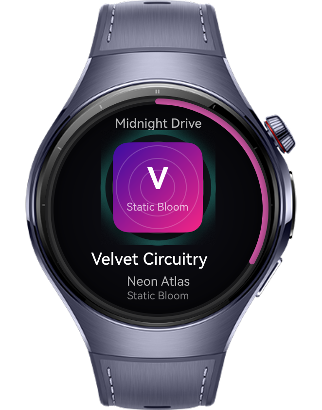
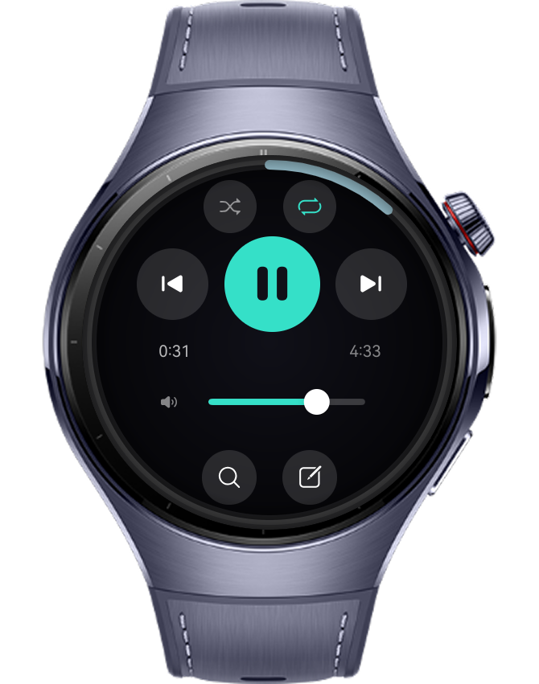
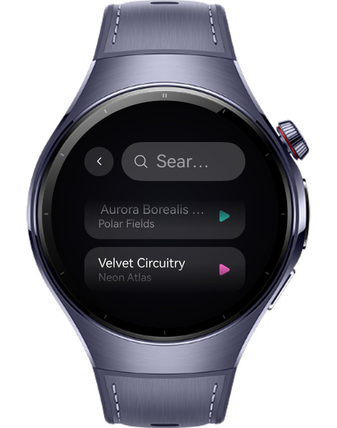
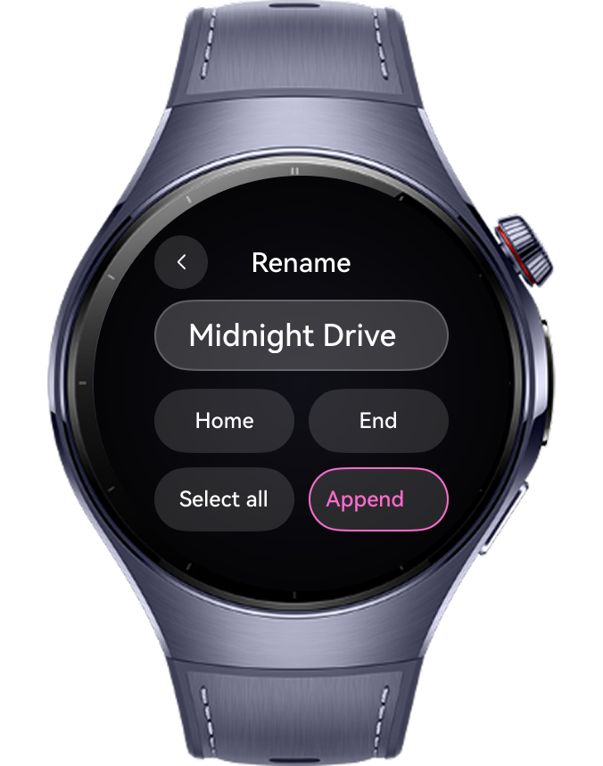

> **Note:** To access all shared projects, get information about environment setup, and view other guides, please visit [Explore-In-HMOS-Wearable Index](https://github.com/Explore-In-HMOS-Wearable/hmos-index).

# How to Build Dynamic Sync Cursor

How to Build Dynamic Sync Cursor is a premium media controller and music remote application specifically designed and optimized for circular wearable devices, featuring frame-accurate synchronized UI animations.

# Preview

<div>    
  
  
  
  
</div> 

# Use Cases

Seamless, premium media playback control directly from your wrist with ultra-smooth UI transitions, responsive text field management for playlist editing, and precise visual feedback tailored for round displays.

- **Now Playing**: A two-state paged face — an album-art / spinning-vinyl focus on top, and the media controls (play/pause, previous, next, shuffle, repeat, volume) one swipe below — with a persistent edge-hugging seek ring.
- **Velocity-Synced Carousel**: Browse albums with a `SwiperDynamicSyncScene` carousel whose spring/friction physics and per-phase frame budgets keep cards tracking the thumb without dropping frames; side cards scale and fade to feel natural on the curved surface.
- **Playback-Synced Title**: Long song titles scroll via a `MarqueeDynamicSyncScene` that pauses with playback and shares the app's master frame-rate timeline.
- **Progress-Locked Rotation**: A vinyl disc rotates in lock-step with the playback position, governed by the shared `DynamicSyncScene` frame budget.
- **Playlist Editing**: Rename playlists with programmatic text-caret control (Home / End / Select all / Append) and an accent-tinted caret.
- **Loupe Inspection**: Long-press album art to reveal a `Magnifier` loupe over the fine liner-note detail.
- **Search**: One clean search field plus a touch-friendly, vertically scrollable song list.

# Tech Stack

- **Languages**: ArkTS
- **Frameworks**: HarmonyOS SDK (Latest Wearable API)
- **Tools**: DevEco Studio
- **Libraries**:
  - @kit.ArkUI
  - @ohos.display
  - DynamicSyncScene
  - SwiperDynamicSyncScene
  - SwiperDynamicSyncSceneType
  - MarqueeDynamicSyncScene
  - MarqueeDynamicSyncSceneType
  - CursorController
  - Magnifier

# Directory Structure

```
HowToBuildDynamicSyncCursor
├── AppScope
│   ├── app.json5
│   └── resources
│       └── base
│           ├── element
│           │   └── string.json
│           └── media
│               └── layered_image.json
├── entry
│   ├── build-profile.json5
│   ├── hvigorfile.ts
│   ├── oh-package.json5
│   └── src
│       ├── main
│       │   ├── ets
│       │   │   ├── common
│       │   │   │   └── AppTheme.ets              # Colour & motion design tokens
│       │   │   ├── entryability
│       │   │   │   └── EntryAbility.ets          # UIAbility entry; full-screen round window
│       │   │   ├── entrybackupability
│       │   │   │   └── EntryBackupAbility.ets
│       │   │   ├── model
│       │   │   │   └── Track.ets                 # Track model + in-memory media library
│       │   │   ├── pages
│       │   │   │   └── Index.ets                 # Circular shell; clip mask, vignette, paging
│       │   │   ├── service
│       │   │   │   ├── DisplayGeometry.ets       # Round-screen geometry (vp, shape, safe square)
│       │   │   │   ├── DynamicSyncHub.ets        # Shared DynamicSyncScene frame-rate authority
│       │   │   │   ├── MarqueeSync.ets           # Marquee scroll/pause profiles
│       │   │   │   └── SwiperSync.ets            # Swiper spring/friction physics profiles
│       │   │   ├── view
│       │   │   │   ├── AlbumArtSwiper.ets        # Velocity-synced album carousel
│       │   │   │   ├── AlbumCover.ets            # Procedurally drawn cover art
│       │   │   │   ├── AlbumDetailLoupe.ets      # Magnifier loupe screen
│       │   │   │   ├── AlbumRotor.ets            # Progress-locked spinning vinyl
│       │   │   │   ├── PlaylistNameEditor.ets    # Rename screen + CursorController/caret
│       │   │   │   ├── ProgressRing.ets          # Edge-hugging seek ring
│       │   │   │   ├── PulseGlow.ets             # Breathing playback halo
│       │   │   │   ├── SearchPanel.ets           # Search field + song list
│       │   │   │   ├── TitleMarquee.ets          # Playback-synced scrolling title
│       │   │   │   └── TransportControls.ets     # Transport buttons + volume slider
│       │   │   └── viewmodel
│       │   │       └── PlayerViewModel.ets       # Observable playback brain
│       │   ├── module.json5
│       │   └── resources
│       │       ├── base
│       │       │   ├── element
│       │       │   ├── media
│       │       │   └── profile
│       │       └── dark
│       │           └── element
│       ├── mock
│       │   └── mock-config.json5
│       ├── ohosTest
│       │   ├── ets
│       │   │   └── test
│       │   │       ├── Ability.test.ets
│       │   │       └── List.test.ets
│       │   └── module.json5
│       └── test
│           ├── List.test.ets
│           └── LocalUnit.test.ets
├── build-profile.json5
├── code-linter.json5
├── hvigorfile.ts
├── oh-package.json5
├── screenshots
├── LICENSE
└── README.md
```

# Constraints and Restrictions

## Supported Devices

- Huawei Watch 5
- HarmonyOS wearable emulator

# LICENSE

How to Build Dynamic Sync Cursor is distributed under the terms of the MIT License.
See the [LICENSE](/LICENSE) for more information.
